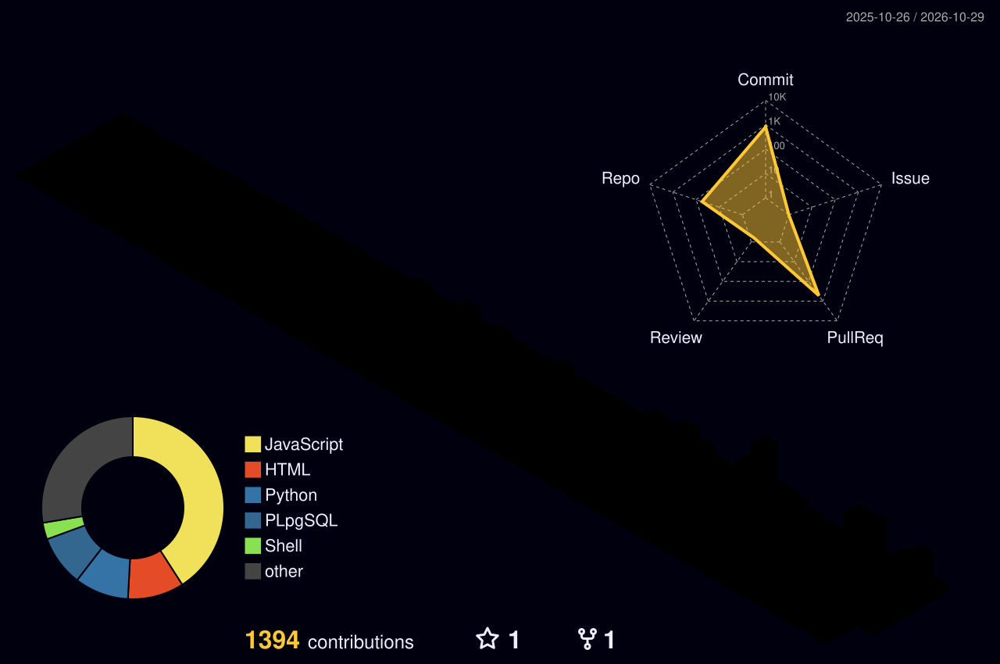

  

 

  

    

  
  
  

<h1 align="center">Hola, soy Henrik Anderson Oloroso García</h1>

  <strong>Técnico en desarrollo de Software | Ciudad de Guatemala, Guatemala</strong>
    
  <em>Profesional curioso, resiliente y apasionado por la tecnología. Enfocado en el desarrollo de APIs REST, modelado y normalización de bases de datos relacionales, contenerización con Docker, Prompt Engineering y automatización de procesos. Con proyección hacia soluciones de software escalables y ciberseguridad.</em>

  

---

## 🎯 Sobre Mí

* Especializado en la creación de APIs REST con Node.js y Express, aplicando asincronía, validación de datos y middlewares.
* Modelado, normalización y consulta de bases de datos relacionales con PostgreSQL y MySQL, incluyendo procedimientos almacenados y PL/pgSQL.
* Uso de Docker para la creación de entornos de trabajo y despliegue modular.
* Automatización de flujos de trabajo con n8n y optimización de tareas mediante Prompt Engineering.
* Experiencia en soporte técnico, diagnóstico de equipos y optimización de inventarios y registros digitales en el Ministerio de la Defensa Nacional.
* **Idiomas**: Español (Nativo) | Inglés C1 (Capacidad técnica y fluidez profesional).
* **Visión**: Crear software eficiente y escalable con especial proyección hacia la ciberseguridad.

---

## 💼 Qué Hago

<table>
  <tr>
    <td width="50%">
      <h3>Desarrollo de Software</h3>
      
Construcción de páginas web interactivas con HTML, CSS y JavaScript, desarrollo de programas de consola, creación de APIs REST con Node.js y Express, y modelado y consulta de datos en bases de datos relacionales.

    </td>
    <td width="50%">
      <h3>Proyectos y Soluciones</h3>
      
Creación de herramientas prácticas para gestión de inventarios, administración de datos multimedia y filtrado eficiente de listas.

    </td>
  </tr>
  <tr>
    <td width="50%">
      <h3>Automatización y Prompt Engineering</h3>
      
Optimización de flujos de trabajo mediante n8n, integración de webhooks, APIs externas y formulación de prompts estructurados para acelerar tareas de desarrollo.

    </td>
    <td width="50%">
      <h3>Contenedores y Entornos</h3>
      
Configuración de contenedores con Docker para estandarizar entornos de desarrollo y facilitar despliegues consistentes.

    </td>
  </tr>
</table>

---

## 🛠️ Stack Tecnológico

### **Backend & Lenguajes**

### **Bases de Datos & Administración**

### **DevOps, Testing & Herramientas**

### **Frontend & Maquetación**

### **Automatización & IA**

### **En Exploración & Práctica Continua**
<em>Tecnologías con las que he trabajado en proyectos y prácticas, actualmente profundizando para consolidar su dominio:</em>  

---

## 🚀 Proyectos Destacados

<table>
  <tr>
    <td width="50%" valign="top">
      <h3>Minerva-lib — Gestor de libros para biblioteca (en desarrollo)</h3>
      
Aplicación para gestionar libros mediante una API y una interfaz web.

      
<strong>Stack:</strong> Node.js, Express, MySQL, HTML, CSS, JavaScript y Docker.

       
      
    </td>
    <td width="50%" valign="top">
      <h3>Countries Express Rate Limit — API REST de países</h3>
      
API con operaciones CRUD, validación de datos y límites de solicitudes. Los datos se almacenan en memoria.

      
<strong>Stack:</strong> Node.js, Express, JavaScript y Docker. <strong>Pruebas:</strong> Postman e Insomnia.

       
      
    </td>
  </tr>
  <tr>
    <td width="50%" valign="top">
      <h3>HYDRA GYM CLI — Sistema de gestión para gimnasio</h3>
      
Aplicación interactiva de consola para administrar clientes, planes de entrenamiento, contratos, membresías, seguimiento físico, planes nutricionales e ingresos y egresos. Incluye consultas y cálculos para apoyar la gestión del centro deportivo.

      
<strong>Stack:</strong> Node.js, JavaScript y MySQL.

       
      
    </td>
    <td width="50%" valign="top">
      <h3>TechZone — Modelo de base de datos para tienda tecnológica</h3>
      
Proyecto de base de datos para una empresa de productos tecnológicos, con definición de tablas, inserción de datos, procedimientos almacenados y consultas.

      
<strong>Stack:</strong> PostgreSQL y PL/pgSQL.

       
      
    </td>
  </tr>
  <tr>
    <td width="50%" valign="top">
      <h3>TutorBot — Bot de tutorías académicas en Telegram</h3>
      
Automatización para gestionar solicitudes de tutorías y conectar estudiantes con tutores según su disponibilidad, con seguimiento del proceso.

      
<strong>Tecnologías:</strong> n8n y Telegram.

       
      
    </td>
    <td width="50%" valign="top">
      <h3>Sistema de gestión de inventario — Python</h3>
      
Aplicación de consola para agregar, listar, actualizar y eliminar productos, además de calcular el valor total del inventario.

      
<strong>Stack:</strong> Python.

       
      
    </td>
  </tr>
</table>

---

## ⚡ Métricas & Actividad en GitHub

  ### Racha de Contribuciones
  

    

  ### Gráfico 3D de Contribuciones
  

---

## 📫 Conecta Conmigo

  
  
  

